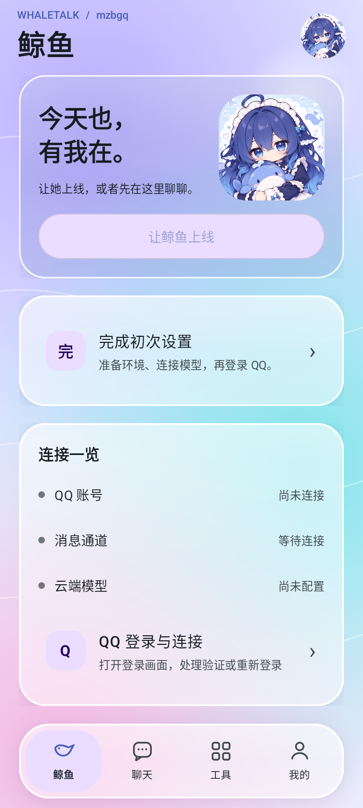
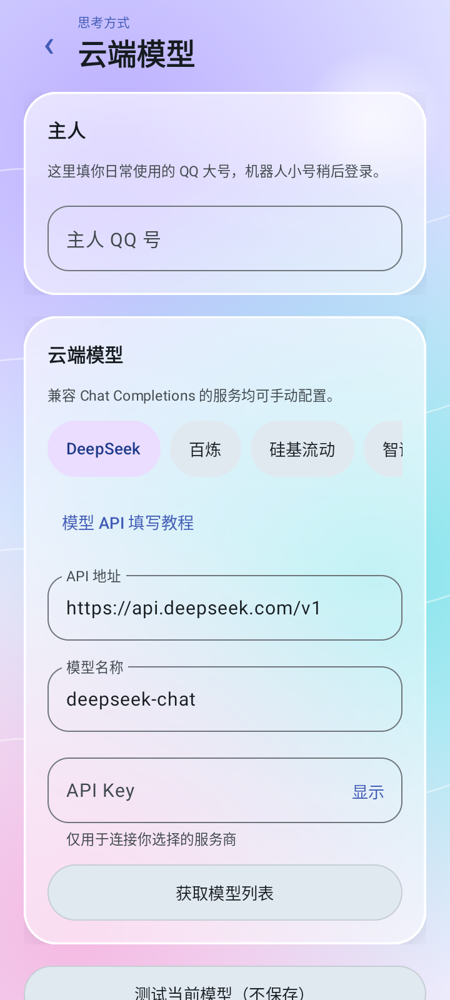
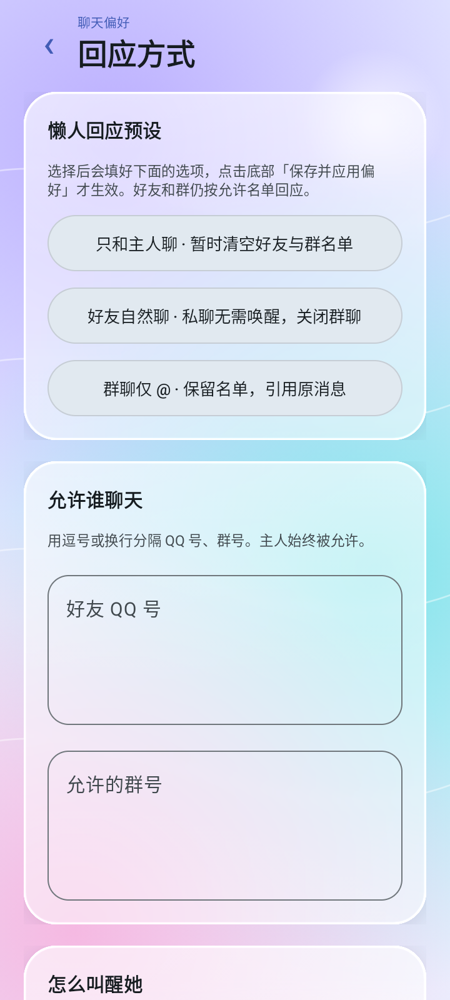
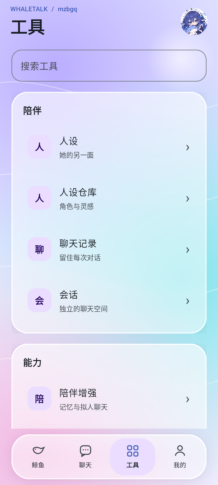

# 鲸语 WhaleTalk

鲸语是面向 Android 手机的 QQ 陪伴机器人应用，提供原生界面管理模型、角色、人设和插件。项目由 **mzbgq** 维护；运行层使用 PRoot、Ubuntu、AstrBot、SnowLuma 和 Linux QQ。文字模型使用你自己配置的云端 API，默认无需额外的记忆 API，语音保持关闭。

> 当前版本为「鲸语 WhaleTalk」**1.6.1**。调整云端模型或回应设置时，消息通道配置不变就能保留 QQ 会话。

## 开始使用

- [安装与上手教程](docs/INSTALL.md)：安装、准备环境、QQ 登录、模型 API、人设及后台设置。
- [常见问题与排障](docs/TROUBLESHOOTING.md)：QQ 在线但不回复、模型错误、环境准备失败。
- [源码构建与签名](docs/BUILD.md)：开发环境、运行资源、构建命令和签名兼容。
- [消息通道说明](docs/消息通道.md) · [历史验证范围](VALIDATION.md) · [第三方依赖与许可](THIRD_PARTY.md)

**[下载鲸语安装包和源码](https://github.com/mzbgq29-ui/WhaleTalk-Android/releases/latest)**。解压 APK ZIP 后安装其中的 APK。鲸语采用独立包名，与旧版并存；如需迁移数据，请先在旧版导出备份，再在鲸语中导入。

## 功能

- 手机内管理 QQ 接入、回复范围、云端模型、插件、知识库和聊天记录。
- 内置酒馆角色仓库，支持导入 V1/V2/V3 PNG 或 JSON 角色卡，静态适配开场和世界书；不执行角色卡脚本。
- 内置陪伴与记忆能力，使用已有聊天模型；可在应用内查看运行日志和备份设置。
- 修复本机 IPC 路径过长导致的消息通道发现问题；QQ 仍为 Linux ARM64 3.2.35-54395（默认锁定，防止热更新替换 hook 模块），SnowLuma 为 2.4.2。

## 界面截图

以下是鲸语 1.6.1 在 Android 模拟器中的应用界面。

  
  
  
  

## 系统要求

Android 8.0 或更新版本、ARM64 手机，无需 root。完整 APK 约 1 GB，准备运行环境需要额外空间，建议预留至少 6 GB。首次准备会解压约 143 MB 的 SnowLuma 运行层，界面会显示真实进度，通常需要几分钟；请保持应用运行，不要因进度条停在一半就强制关闭。网络、QQ 平台或模型服务变化可能影响连接。

## 参与与反馈

阅读 [贡献指南](.github/CONTRIBUTING.md) 后提交 Issue 或 Pull Request。反馈前可查看 [排障指南](docs/TROUBLESHOOTING.md)；请先移除账号、会话、API Key、密码与完整日志中的隐私信息。安全问题按 [SECURITY.md](SECURITY.md) 提交。

应用源码遵循仓库内的 [MIT 许可](LICENSE)，第三方软件、素材及角色卡各自的来源和许可见 [THIRD_PARTY.md](THIRD_PARTY.md) 与 `docs/legal/`。QQ 和 SnowLuma 专有二进制依赖不是本仓库拥有的源码；请遵守各自的使用条款。
